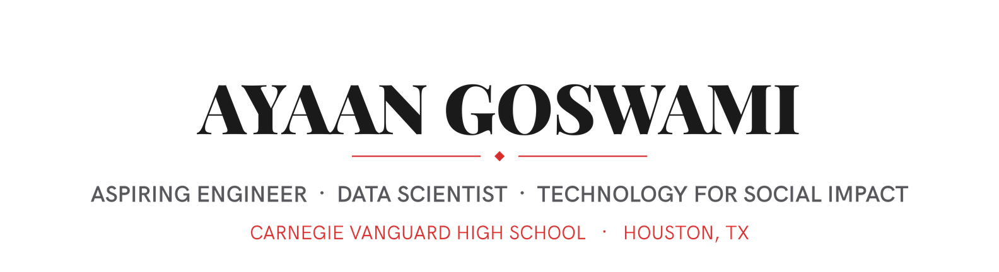
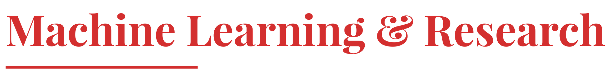
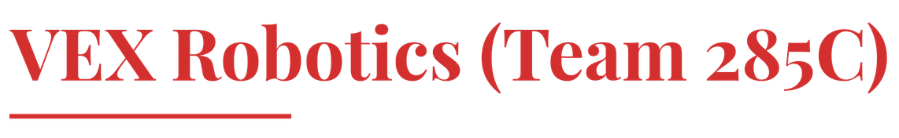
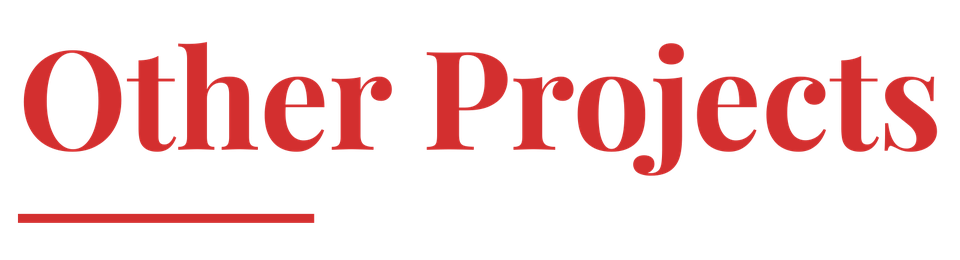
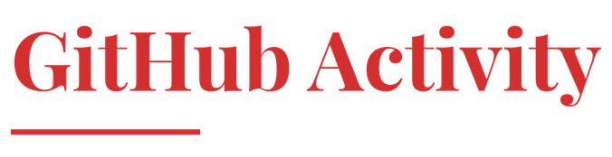
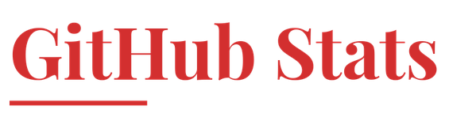

<picture>
  <source media="(prefers-color-scheme: dark)" srcset="./assets/hero-dark.png">
  
</picture>

  
  &ensp;
  
  &ensp;
  
  &ensp;
  

 

<i>I like taking projects from a rough idea to something people can actually use, whether that is 
a model, a robot, or a web app. Most of what is here started as a question I was curious about.</i>

 

Houston, TX &nbsp;·&nbsp; Carnegie Vanguard High School, Class of 2027 &nbsp;·&nbsp; VEX Robotics 285C &nbsp;·&nbsp; AI YES Hackathon Gold Award

 

<strong>PYTHON</strong> &nbsp;·&nbsp; <strong>C++</strong> &nbsp;·&nbsp; <strong>JAVASCRIPT</strong> &nbsp;·&nbsp; <strong>TYPESCRIPT</strong> &nbsp;·&nbsp; <strong>NEXT.JS</strong> &nbsp;·&nbsp; <strong>REACT</strong> &nbsp;·&nbsp; <strong>PYTORCH</strong> &nbsp;·&nbsp; <strong>SUPABASE</strong> &nbsp;·&nbsp; <strong>ARDUINO</strong> &nbsp;·&nbsp; <strong>CAD</strong> &nbsp;·&nbsp; <strong>LATEX</strong>

  

 

&nbsp; <strong><a href="https://github.com/JaukG9/mental-health-sentiment-analysis">Mental Health Sentiment Analysis</a></strong>: lightweight BERT-based and Random Forest pipeline for automated mental health text triage (about 85% accuracy), deployed on Hugging Face Spaces with a GitHub Pages frontend. Published in the <a href="https://doi.org/10.67149/yhjs2024.5/5wcbbc4m">International Journal of Secondary Computing and Applications Research</a>. 
&nbsp; <strong><a href="https://github.com/JaukG9/voice-health">Voice Health</a></strong> <em>(in progress)</em>: XGBoost model on the UCI Parkinson's voice dataset, with SHAP for interpreting vocal biomarkers. It grew out of a technical assessment for a university research lab application. 
&nbsp; <strong><a href="https://github.com/JaukG9/Parkinsons-Arduino">Parkinson's TinyWatch</a></strong>: an Arduino-based wearable for Parkinson's patients, built at Rice DHYS. It combines a pulse oximeter, an accelerometer and Bluetooth to track movement and vitals in real time and alert a caregiver when needed. 
&nbsp; <strong><a href="https://github.com/JaukG9/showdown-AI">Pokémon Showdown AI</a></strong> <em>(in progress)</em>: a supervised imitation-learning AI for competitive Pokémon Showdown (Gen 9 OU), built as a residual MLP trained on a 725-dimensional feature vector from my own gameplay data, collected through a terminal proxy bot using poke-env. 
&nbsp; <strong>AP Research</strong>: a quantitative study of implicit and adaptive video game tutorials in gamified education, comparing player performance and engagement across 6 conditions. The paper has been submitted to the International Journal of High School Research (IJHSR). The game I built for it is <a href="https://github.com/JaukG9/2DPlatformer-IAGE">IAGE 2D Platformer</a>.

I'm programming lead for VEX Robotics Team 285C at Carnegie Vanguard (since February 2024), and we have qualified for the VEX Worlds level. I program the robot with PROS, LemLib and the VEXcode API.

&nbsp; <strong><a href="https://github.com/JaukG9/VEX-Template-285C">VEX V5 Template</a></strong>: a template for VEX V5 programming built on PROS and LemLib. 
&nbsp; <strong><a href="https://github.com/JaukG9/Pushback-285C">Pushback 285C</a></strong>: competition code for the Pushback season for 285C Discobots Chaos. 
&nbsp; <strong><a href="https://github.com/JaukG9/Override-285C">Override 285C</a></strong>: competition code for the Override season for 285C Discobots Chaos.

Outside competition code, I designed automatic motion-chaining formulas for LemLib's `moveToPoint()` and `turnToHeading()`, using kinematic stopping distance and trapezoidal or triangular motion profiles so the robot carries its current speed into the next movement instead of stopping and restarting between points.

&nbsp; <strong>AI YES International Youth AI Hackathon</strong>: with one teammate from Carnegie Vanguard, I built a student mental health submission for the Fall 2026 hackathon and won the <strong>Gold (highest) Award</strong>. 
&nbsp; <strong>Growth Hormone Therapy Tracker</strong>: a mobile app for daily growth hormone therapy, with injection rotation tracking, growth analytics and doctor reports. It is live on the App Store and Google Play, with 110+ families using it. 
&nbsp; <strong><a href="https://project-1600-one.vercel.app">Project 1600</a></strong>: a full-stack SAT/PSAT prep platform built with Next.js 15, TypeScript, Supabase and Stripe, with mentor and student dashboards, enrollment workflows and a multi-step checkout. I am cofounder and CTO. 
&nbsp; <strong><a href="https://github.com/JaukG9/APUSH-Practice">APUSH-Practice</a></strong>: a gamified AP US History practice site.

&nbsp; <strong>Hoplynk</strong>, Intern (Jul 2026 to present): audited the model architecture of an AI-agent platform at a defense-tech startup, then designed a benchmarking framework for comparing LLMs, prompts and providers on tool-call accuracy, safety and task success. 
&nbsp; <strong>Project 1600</strong>, Cofounder &amp; CTO (Jun 2026 to present): built the platform and tutored 50+ students in SAT, ACT and AP subjects. 
&nbsp; <strong>Mu Alpha Theta</strong>, Vice President (Apr 2024 to present): tutored 60+ students in Algebra 1 through PreCalculus and competed in the AMC 10, AMC 12 and UH Math Contest. 
&nbsp; <strong>Common Grounds Club</strong>, Vice President (Sep 2023 to present): hosted a Houston-wide meeting of 50 members from eight schools for respectful debate on controversial topics. 
&nbsp; <strong>UNICEF Club</strong>, Vice President (Sep 2025 to present): organized fundraising for children's education and health, including Trick-or-Treat for UNICEF. 
&nbsp; <strong>Rice University DHYS</strong> (Jun to Jul 2025): designed and prototyped the Parkinson's wearable in this federally funded digital health program, and presented the poster solo to a panel of judges at the symposium. 
&nbsp; <strong>Nimble Mindset</strong>, Intern (Jun to Aug 2025): edited podcasts and interview questions, and helped improve the website UI. 
&nbsp; <strong>Kumon</strong>, Tutor (Jan to Apr 2024): taught math and reading to 200+ students from preschool to high school. 
&nbsp; <strong>Community service</strong>: Assamese Foundation of North America organizing committee (including an annual 5k), Houston Food Bank, CVHS I-Fest, NAQT scorekeeping, and NHS and MAΘ tutoring.

&nbsp; <strong>Gold Award</strong>, Fall 2026 AI YES International Youth AI Hackathon 
&nbsp; <strong>Silver Division</strong>, USA Computing Olympiad 
&nbsp; <strong>Gold Award</strong>, Bebras Computing Challenge 
&nbsp; <strong>VEX Robotics Worlds Qualifier</strong>, team 285C 
&nbsp; <strong>IBM Data Science Professional Certificate</strong> (Coursera, July 2026): 12 courses and 170 hours, completed independently.

&nbsp; <strong>School</strong>: Carnegie Vanguard High School, diploma June 2027. 4.00 unweighted GPA, ranked 5th in my class, SAT 1580. 
&nbsp; <strong>AP</strong>: 5s in Human Geography, Precalculus, Statistics, World History, Spanish Language, Computer Science A, Calculus BC, Chemistry, Physics and Research. Currently taking Physics C, Macroeconomics and Government, English Literature, and Business and Personal Finance. 
&nbsp; <strong>Interests</strong>: electrical and computer engineering, computer science, data science, robotics, game development and digital health. 
&nbsp; <strong>Outside the screen</strong>: piano since 2013, guitar, a black belt in Kuk Sool Won, and JV cross country.

  

<picture>
  <source media="(prefers-color-scheme: dark)" srcset="https://raw.githubusercontent.com/JaukG9/JaukG9/output/snake-dark.svg">
  
</picture>

  

  

<picture>
  <source media="(prefers-color-scheme: dark)" srcset="https://github-stats-extended.vercel.app/api?username=JaukG9&show_icons=true&hide_border=true&title_color=d32f2f&icon_color=d32f2f&text_color=f5f5f5&bg_color=00000000">
  
</picture>
<picture>
  <source media="(prefers-color-scheme: dark)" srcset="https://github-stats-extended.vercel.app/api/top-langs/?username=JaukG9&layout=compact&hide_border=true&title_color=d32f2f&text_color=f5f5f5&bg_color=00000000">
  
</picture>

  

  

This updates as projects wrap up or new ones start. The repos are the source of truth.

  

More at <a href="https://ayaangoswami.dev"><strong>ayaangoswami.dev</strong></a>

